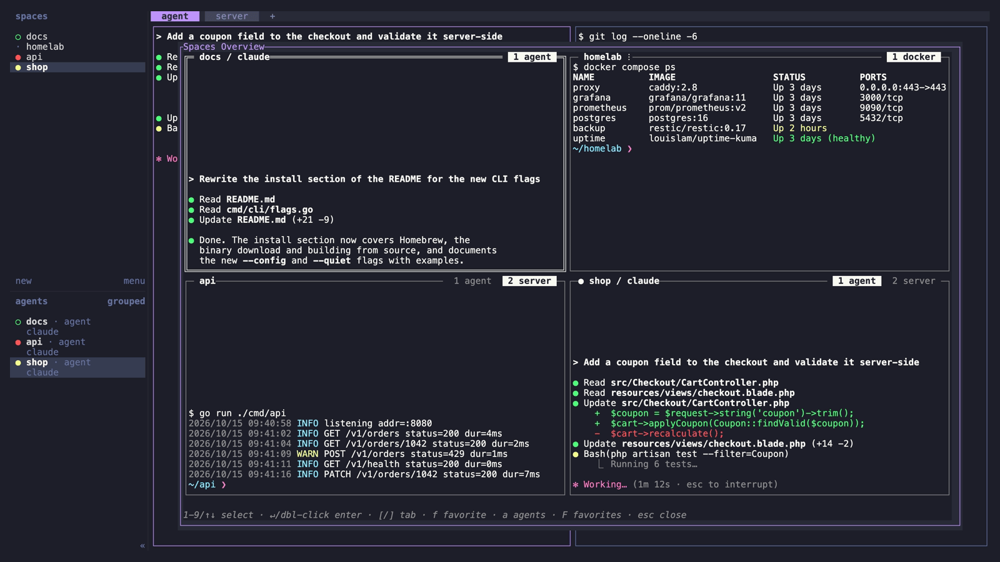
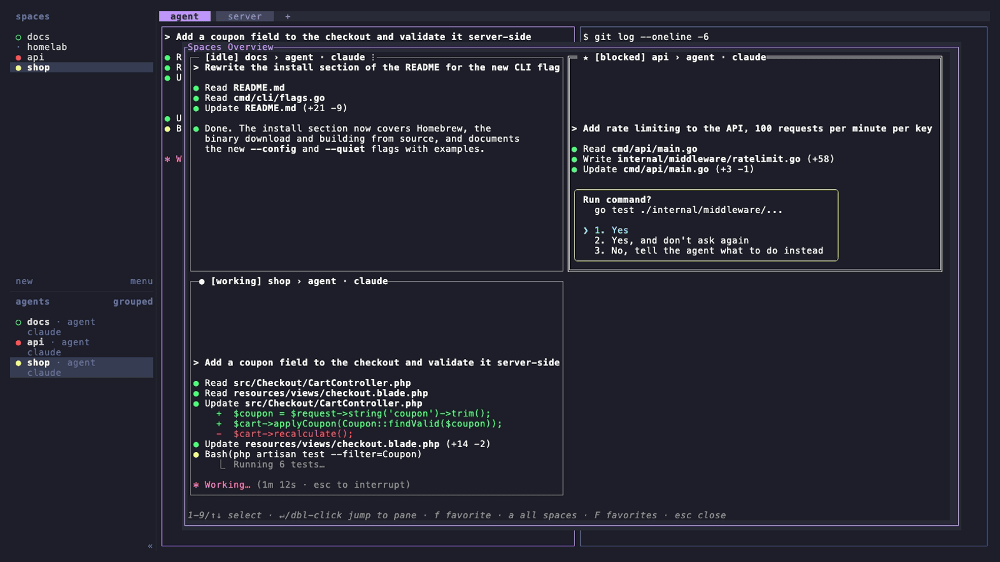

# herdr-overview

Mission Control for [herdr](https://herdr.dev): a live, tiled overview of all your spaces, of every agent, or of the panes you marked as favorites. Press **alt+o**, glance at everything, hit **Enter** to jump in.



Each tile mirrors the *actual* terminal content of a pane, with colors and styling, updated about four times per second. It is not a summary or a status card. The overview is read-only: your spaces are never moved, resized or refocused.

## Filters

| Key | View |
|---|---|
| `a` | **Agents**: one tile per agent pane across all spaces and tabs, also agents in background tabs. The header shows the agent state first (`[working]`, `[blocked]`, `[done]`, …). |
| `F` | **Favorites**: one tile per pane you marked with `f`, across all spaces and tabs. |

Press the same key again to get back to all spaces. The overview remembers the last filter and your favorites for the next time you open it. Closed panes drop out of the favorites.



## Keys

| Key | Action |
|---|---|
| `↑↓` / `h j k l` / click | select a tile |
| `1`-`9` | jump into that tile |
| `Enter` / double-click | jump into the selected space, or straight to the pane with a filter |
| `f` | mark / unmark the selected pane as a favorite (★) |
| `a` / `F` | toggle the agents / favorites filter |
| `[` `]` / click a tab | switch the space's active tab (all spaces view) |
| `Esc` / `q` / **alt+o** | close |

Closing restores exactly where you were, since the overview is a popup.

## Requirements

`node` 18 or newer on `PATH` (no npm dependencies).

## Install

```sh
herdr plugin install baeroe/herdr-overview
```

Add a key binding to `~/.config/herdr/config.toml`:

```toml
[[keys.command]]
key = "alt+o"
type = "plugin_action"
command = "herdr-overview.open"
description = "overview"
```

Then run `herdr server reload-config`.

## Configuration

Optional, in `$(herdr plugin config-dir herdr-overview)/config.toml`:

```toml
filter = "all"          # view on first open: "all", "agents" or "favorites" (afterwards the last one is remembered)
refresh_hz = 4          # 1-10, tile update rate
scale_mode = "crop"     # "crop" = readable 1:1 live tail (default), "fit" = scaled-down whole viewport
show_space_name = true  # space (and tab) name in the tile header
show_pane_label = true  # pane or agent name in the tile header
log_debug = false       # debug log in the plugin state dir
```

Terminal cells can't be scaled down, so a pane larger than its tile is cropped to its **live tail**: the bottom rows, where the prompt, the latest output and an agent's input box are. Cropped tiles show a `⋮` in the header.

## Tests

```sh
node --test test/*.test.js   # ANSI parser, layout and renderer (runs in CI)
```

How the plugin talks to herdr is documented in [docs/TECHNICAL-NOTE.md](docs/TECHNICAL-NOTE.md).

## Screenshots

The screenshots are generated with [VHS](https://github.com/charmbracelet/vhs) from the tapes in `docs/tapes/`, against a throwaway herdr server with demo data (your own herdr is not touched):

```sh
bash docs/screenshots.sh          # all, or e.g. `bash docs/screenshots.sh agents`
```

## License

MIT, see [LICENSE](LICENSE).
